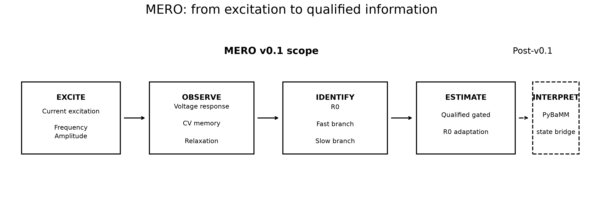
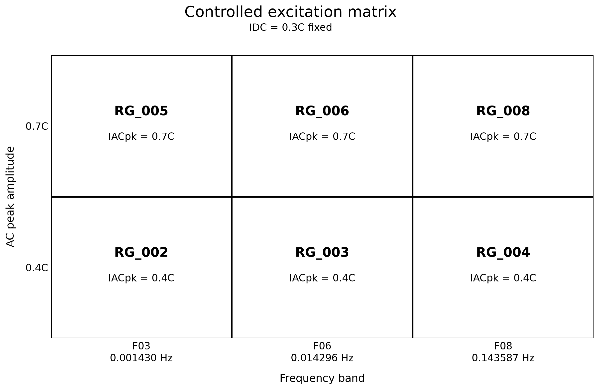
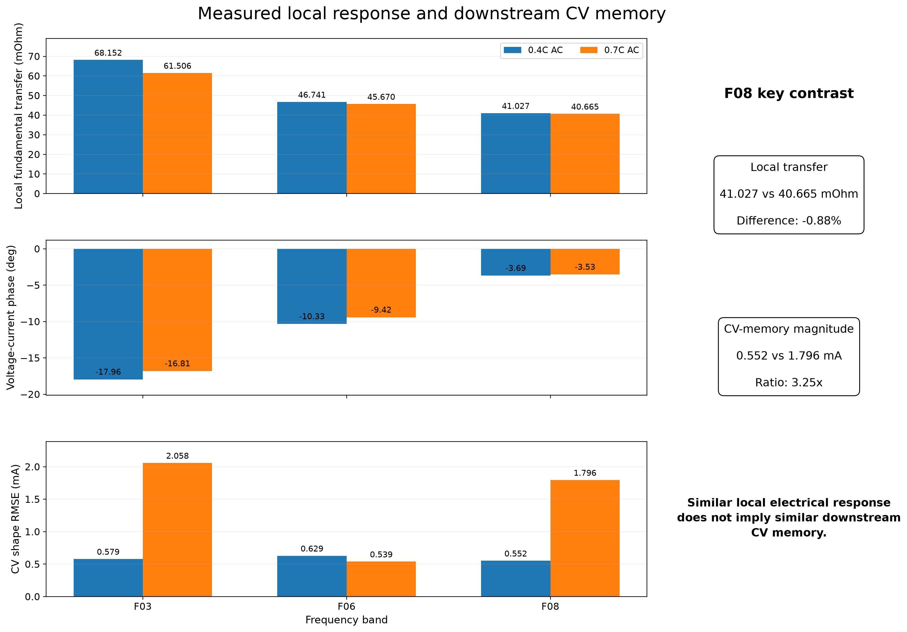
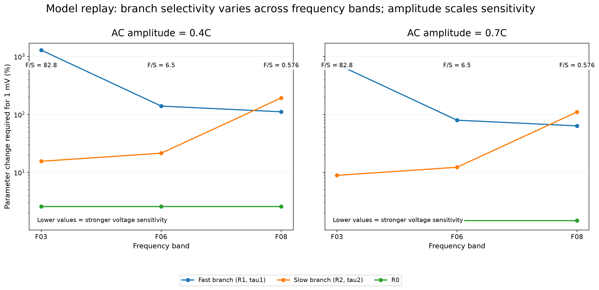
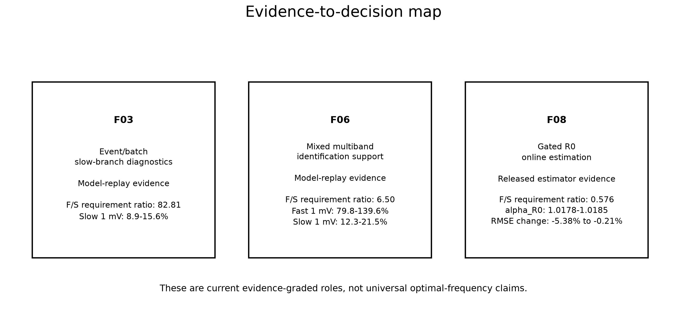
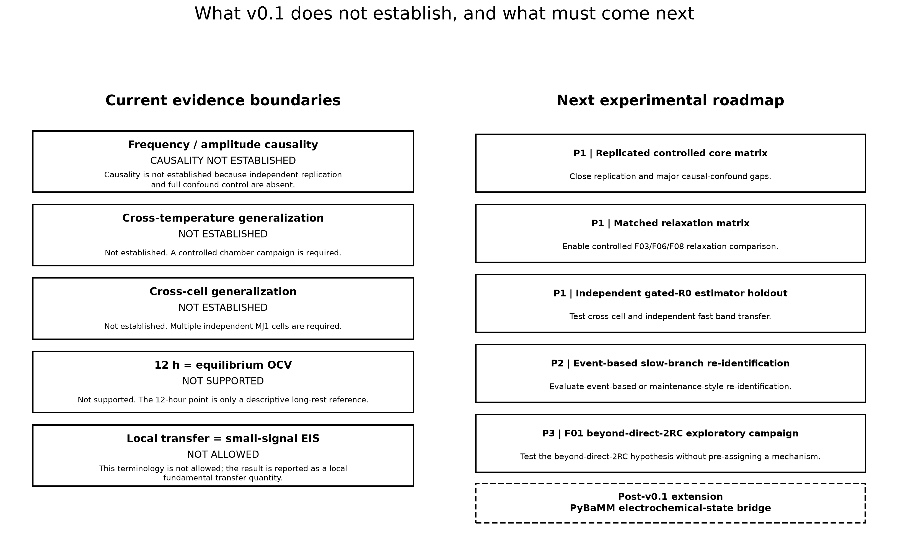

# MJ1 Multiscale Excitation-Response Observability (MERO)

**An evidence-graded framework linking multiscale current excitation to measurable battery response, parameter identifiability, and estimator qualification.**

**Release scope:** MERO v0.1  
**Cell system:** LG INR18650 MJ1  
**Current status:** v0.1 analysis closed; electrochemical interpretation is reserved for the post-v0.1 PyBaMM extension.

MERO asks a practical question:

> How should current excitation be distributed across timescales so that different battery dynamics become observable, identifiable, and ultimately useful for state estimation?

The project does not search for a universal "best frequency." Instead, it separates four evidence layers:

**Excite -> Observe -> Identify -> Estimate**



---

## Research question

The central research question is:

> How should current excitation be designed across timescales to selectively reveal different lithium-ion battery dynamics, and which measurable voltage, CV-memory, thermal, and relaxation responses contain enough information to support parameter identification and state estimation?

MERO v0.1 focuses on externally observable and estimator-relevant information.

Electrochemical mechanism interpretation is intentionally not assigned in v0.1. That question is reserved for the planned PyBaMM electrochemical-state bridge.

---

## What was tested

The controlled core matrix fixes the DC charging component at **0.3C** and varies:

- three measured excitation bands;
- two AC peak amplitudes.

The controlled bands are:

| Band | Measured frequency | Approx. period |
|---|---:|---:|
| F03 | 0.001430 Hz | ~699 s |
| F06 | 0.014296 Hz | ~70 s |
| F08 | 0.143587 Hz | ~6.96 s |

The AC peak amplitudes are:

- 0.4C;
- 0.7C.

This produces six controlled DC-AC conditions.



### Data and publication scope

This public repository contains curated, English-only derived evidence tables, documentation, and reproducible figures for MERO v0.1. It does not mirror the raw source repositories or local machine-specific provenance paths.

The scientific conclusions were frozen during the local MERO v0.1 closeout. The public tables are curated views of those frozen outputs rather than a re-analysis of the raw source data.

See [`docs/PUBLICATION_SCOPE.md`](docs/PUBLICATION_SCOPE.md) for the public-release boundary.

The public numerical representation of this matrix is available in:

[`data/mero_controlled_decision_matrix_v0_1.csv`](data/mero_controlled_decision_matrix_v0_1.csv)

---

## How to read the evidence

MERO deliberately separates evidence types.

| Evidence type | Meaning |
|---|---|
| Measured response | Direct observation from the controlled recording group |
| Model replay | Structural or practical identifiability evaluated with the frozen 2RC model |
| Released estimator evidence | Performance evidence from the released gated Bayesian R0 estimator |
| Protocol-level relaxation bridge | Matching protocol descriptors across datasets without claiming same physical-run identity |

This distinction is important because:

> **Observable does not necessarily mean identifiable. Identifiable does not necessarily mean transferable. Transferable does not necessarily mean qualified for online adaptation.**

---

## What the measurements show

The measured local fundamental transfer magnitude shows the same descriptive ordering at both AC amplitudes:

**0.4C AC**

- F03: 68.152 mOhm
- F06: 46.741 mOhm
- F08: 41.027 mOhm

**0.7C AC**

- F03: 61.506 mOhm
- F06: 45.670 mOhm
- F08: 40.665 mOhm

The voltage-current phase also moves progressively toward zero from F03 to F08.

These are descriptive measured-response patterns. They are not presented as a universal impedance law or as proof of physical frequency causality.



### A key F08 contrast

The F08 conditions provide one of the clearest MERO observations.

Local fundamental transfer is nearly unchanged:

- 0.4C AC: **41.027 mOhm**
- 0.7C AC: **40.665 mOhm**
- relative difference: **-0.88%**

However, the downstream CV-shape RMSE changes substantially:

- 0.4C AC: **0.552 mA**
- 0.7C AC: **1.796 mA**
- ratio: **3.25x**

Therefore:

> **Similar local electrical response can coexist with substantially different downstream CV memory.**

This is one of the main reasons MERO treats local active response and downstream memory as different observation stages.

The corresponding public response table is:

[`data/mero_controlled_response_summary_v0_1.csv`](data/mero_controlled_response_summary_v0_1.csv)

---

## What information does each frequency band carry?

The next layer asks whether the measured excitation contains enough model information to distinguish different 2RC parameter groups.

The metric shown below is the parameter change required to produce approximately 1 mV of terminal-voltage change.

**Lower values indicate stronger voltage sensitivity.**



### Branch selectivity

The fast-to-slow requirement ratio is almost unchanged when AC amplitude increases from 0.4C to 0.7C:

| Band | 0.4C AC | 0.7C AC | Interpretation |
|---|---:|---:|---|
| F03 | 82.814 | 82.812 | Strong slow-branch preference |
| F06 | 6.496 | 6.496 | Mixed / intermediate region |
| F08 | 0.576 | 0.576 | Information shifts toward the fast branch |

Within the frozen 2RC model replay:

> **Frequency primarily changes branch-selectivity geometry, while excitation amplitude primarily scales signal strength.**

This is a model-replay result, not a universal physical causality claim.

### Amplitude scaling

Increasing AC amplitude from 0.4C to 0.7C reduces the parameter change required to produce the same 1 mV voltage effect.

Examples include:

| Quantity | 0.4C AC | 0.7C AC |
|---|---:|---:|
| F03 slow branch | 15.583% | 8.904% |
| F06 fast branch | 139.592% | 79.767% |
| F08 fast branch | 111.348% | 63.623% |
| R0 | ~2.580% | ~1.474% |

The reduction is approximately consistent with the change in excitation amplitude.

However, the measured CV-memory results show that higher amplitude is not "free information": downstream memory can change substantially at the same time.

The public identifiability table is:

[`data/mero_identifiability_summary_v0_1.csv`](data/mero_identifiability_summary_v0_1.csv)

---

## Why R0 is the only currently qualified online-adaptation target

Within the frozen 2RC model replay, R0 produces a stronger terminal-voltage response per percentage parameter change than either dynamic RC branch.

At 0.7C AC, for example:

- lowest slow-branch replay requirement: **8.904%** for approximately 1 mV;
- lowest fast-branch replay requirement: **63.623%** for approximately 1 mV;
- R0 replay requirement: **~1.474%** for approximately 1 mV.

However, strong identifiability alone is not enough to justify online adaptation.

The frozen qualification status is:

| Parameter target | Current status |
|---|---|
| R0 | Qualified within the released gated Bayesian v1.0 scope |
| R1 / tau1 | Not qualified |
| R2 / tau2 | Not qualified; continuous adaptation closed |
| R1 / tau1 / R2 / tau2 jointly | Not qualified |

The key distinction is:

> **Identifiable does not mean transferable.**

R2/tau2 can carry useful information under F03 and F06, but the measured-voltage optimum did not transfer reliably across SOC, frequency, amplitude, and model/baseline treatment. Continuous slow-branch adaptation was therefore closed.

### R0 estimator evidence

Two protocol-matched F08 estimator-evidence cases illustrate another important distinction. The bridge is based on protocol condition; same physical-run identity between the MERO recording groups and estimator cases is not established here.

| Condition | Final alpha_R0 | Frozen voltage RMSE | Adaptive voltage RMSE | RMSE change |
|---|---:|---:|---:|---:|
| 0.3C + 0.4C | 1.017798 | 4.3379 mV | 4.3289 mV | -0.2063% |
| 0.3C + 0.7C | 1.018477 | 4.0219 mV | 3.8056 mV | -5.3781% |

The inferred R0 correction is similar, but the estimator benefit magnitude is very different.

Therefore:

> **Transferable parameter correction and condition-specific estimator benefit are not the same quantity.**

A universal 5.38% estimator improvement is not supported.

The corresponding public estimator table is:

[`data/mero_r0_estimator_evidence_v0_1.csv`](data/mero_r0_estimator_evidence_v0_1.csv)

---

## Current evidence-to-decision map

The current evidence supports different roles for the three controlled bands.



### F03

**Current role:** event-based or batch slow-branch diagnostics.

F03 provides the strongest current slow-branch information in the frozen model replay, but it does not qualify continuous R2/tau2 online adaptation.

### F06

**Current role:** mixed multiband identification support.

F06 retains useful slow-branch information while providing much stronger fast-branch information than F03.

### F08

**Current role:** gated R0 online estimation.

F08 is the only controlled band in MERO v0.1 with direct released estimator-performance evidence.

Its special role does **not** come from uniquely higher R0 model-replay sensitivity. At fixed amplitude, R0 sensitivity is approximately frequency-independent across F03, F06, and F08.

The F08 role instead comes from the released fast-excitation gate and estimator qualification.

> These are evidence-graded design roles, not universal optimal-frequency claims.

---

## Additional long-rest evidence

The current historical dataset contains one full protocol-level bridge between the controlled matrix and post-charge relaxation:

**RG_002 <-> PF_0009**

Protocol descriptors match at:

- IDC = 0.3C;
- IACpk = 0.4C;
- F03.

Relative to the 12-hour descriptive reference, the median relaxation-voltage offsets are:

| Rest target | Median voltage offset vs 12 h |
|---|---:|
| 10 min | +14.9 mV |
| 1 h | +8.2 mV |
| 3 h | +4.6 mV |
| 12 h | 0 mV |

The 10-minute, 1-hour, and 3-hour voltage ranges remain separated from the 12-hour range.

This indicates that a measurable voltage separation from the 12-hour descriptive reference remains at the 3-hour observation point.

Two boundaries are essential:

1. the 12-hour point is a descriptive long-rest reference, not an equilibrium OCV claim;
2. RG_002 and PF_0009 share a protocol descriptor class, but same physical-run identity is not established.

The public relaxation table is:

[`data/mero_relaxation_bridge_v0_1.csv`](data/mero_relaxation_bridge_v0_1.csv)

---

## What v0.1 does not establish

MERO v0.1 is designed to preserve evidence boundaries rather than convert every observed pattern into a causal claim.



The current evidence does **not** establish:

- strict physical frequency causality in the historical experiments;
- strict physical amplitude causality in the historical experiments;
- independent replication;
- cross-cell generalization;
- cross-temperature generalization;
- equilibrium OCV at 12 hours;
- equivalence between the local fundamental transfer and small-signal EIS impedance;
- a universal optimal excitation frequency.

The full public claim matrix is available here:

[`data/mero_claim_matrix_v0_1.csv`](data/mero_claim_matrix_v0_1.csv)

---

## What comes next

The highest-priority experimental gaps are:

| Priority | Experiment | Purpose |
|---|---|---|
| P1 | Replicated controlled core matrix | Test repeatability and close major causal-confound gaps |
| P1 | Matched relaxation matrix | Enable controlled F03/F06/F08 relaxation comparison |
| P1 | Independent gated-R0 estimator holdout | Test cross-cell and independent fast-band transfer |
| P2 | Event-based slow-branch re-identification | Test maintenance-style R2/tau2 identification without continuous adaptation |
| P3 | F01 beyond-direct-2RC campaign | Explore ultra-slow observables without pre-assigning a mechanism |

The complete public experiment matrix is:

[`data/mero_next_experiment_matrix_v0_1.csv`](data/mero_next_experiment_matrix_v0_1.csv)

---

## Post-v0.1: PyBaMM electrochemical-state bridge

MERO v0.1 ends at:

```text
Excite -> Observe -> Identify -> Estimate
```

The next research phase adds:

```text
Excite -> Observe -> Identify -> Estimate -> Interpret
```

The first planned electrochemical-state contrast is:

**RG_004 vs RG_008**

Both are F08 conditions.

Their local fundamental transfer is similar:

- RG_004: 41.027 mOhm
- RG_008: 40.665 mOhm

but their downstream CV-memory magnitude is very different:

- RG_004: 0.552 mA
- RG_008: 1.796 mA

The planned PyBaMM bridge will test whether this divergence corresponds to different internal electrochemical-state trajectories.

Candidate internal quantities include:

- solid-phase concentration gradients;
- electrolyte concentration gradients;
- reaction overpotentials;
- through-electrode reaction-current distributions;
- negative-electrode potential margin.

No mechanism is pre-assigned.

The objective is to test whether:

> **Similar terminal response can coexist with different internal electrochemical states.**

---

## Reproducibility

The public figures are generated directly from the frozen English-only public tables.

Install the required plotting dependency:

```bash
python -m pip install -r requirements.txt
```

Regenerate all six README figures:

```bash
python scripts/generate_readme_figures_v0_1.py
```

The figure-generation pipeline verifies:

- controlled-condition mapping;
- English-only publication content;
- zero CJK characters in public text assets;
- zero local absolute user paths;
- figure-to-source traceability.

Figure provenance is recorded in:

[`provenance/readme_figure_manifest_v0_1.csv`](provenance/readme_figure_manifest_v0_1.csv)

The curated public repository manifest is:

[`provenance/publication_manifest_v0_1.csv`](provenance/publication_manifest_v0_1.csv)

---

## Repository structure

```text
MJ1_Multiscale_Excitation_Response_Observability/
|
|-- data/
|   |-- mero_controlled_decision_matrix_v0_1.csv
|   |-- mero_controlled_response_summary_v0_1.csv
|   |-- mero_identifiability_summary_v0_1.csv
|   |-- mero_r0_estimator_evidence_v0_1.csv
|   |-- mero_relaxation_bridge_v0_1.csv
|   |-- mero_claim_matrix_v0_1.csv
|   `-- mero_next_experiment_matrix_v0_1.csv
|
|-- figures/
|   |-- fig01_mero_architecture.png
|   |-- fig02_controlled_excitation_matrix.png
|   |-- fig03_measured_response_summary.png
|   |-- fig04_identifiability_selectivity.png
|   |-- fig05_evidence_to_decision_map.png
|   |-- fig06_evidence_boundaries_roadmap.png
|   `-- FIGURE_INDEX.md
|
|-- scripts/
|   `-- generate_readme_figures_v0_1.py
|
|-- docs/
|   |-- MERO_v0_1_CLOSEOUT.md
|   |-- PUBLICATION_SCOPE.md
|   `-- README_VISUAL_PLAN.md
|
|-- provenance/
|   |-- publication_manifest_v0_1.csv
|   |-- public_repository_build_report_v0_1.csv
|   `-- readme_figure_manifest_v0_1.csv
|
|-- requirements.txt
|-- .gitignore
`-- .gitattributes
```

---

## v0.1 status

**Analysis:** closed  
**Public data package:** built  
**Figure set:** frozen  
**English-only publication gate:** passed  
**Local-path privacy gate:** passed  
**Electrochemical interpretation:** post-v0.1

MERO v0.1 should be read as an evidence-graded observability and identifiability study, not as a universal frequency-optimization result.

---

## License

This repository is released under the [MIT License](LICENSE).

Copyright (c) 2026 Jiaxing Lu.

